# System Validation Report

Peer-to-Peer Tutoring Scheduler (Jira PTS-44, Part-3 item 2b(ii))

| Item | Value |
|---|---|
| Author | Kaustubh Akash |
| Date | 7 November 2026 |
| System version | main after the Sprint 2 merges (PTS-24 to PTS-38, PTS-42, PTS-43) |
| Companion documents | Test_Cases_and_RTM.md (PTS-42), Unit_Test_Report.md (PTS-43), SRS.pdf, STP.pdf |

This report records, for each SRS requirement, the test that checked it, the result, and the evidence. Evidence comes from the automated tests (Jest, Playwright, axe, k6) and from a manual walkthrough with screenshots (section 6). Anything that was not tested is marked Not validated and is not counted as passed.

## 1. Summary

| Result | Functional (24) | Non-functional (7) | Security (6) | Total (37) |
|---|---|---|---|---|
| Met | 17 | 2 | 2 | 21 |
| Partially met | 3 | 2 | 2 | 7 |
| Manual walkthrough only | 1 | 0 | 0 | 1 |
| Not built | 3 | 0 | 0 | 3 |
| Not validated | 0 | 3 | 2 | 5 |

Test runs behind these numbers:

| Test level | Tool | Result |
|---|---|---|
| Backend unit and integration | Jest + Supertest | 106 of 106 tests passed (15 suites). Coverage 89.47% statements, 77.77% branches. Lint: 0 errors. (Unit_Test_Report.md, Test_Cases_and_RTM.md) |
| End-to-end | Playwright (Chromium, desktop 1280x720 and mobile 360x640) | 21 tests passed on 3 consecutive full runs (night of 5 to 6 November 2026) |
| Accessibility | axe-core (WCAG 2.1 A and AA) on 8 pages at 1280 px and 360 px | 6 pages clean. /calendar and /my-slots have serious violations (section 4) |
| Performance | k6, 100 virtual users, 5 minutes | p95 = 39.52 ms, 0.00% failed requests. Booking path not representative (section 3) |
| Staging | scripts/smoke.sh in CI | Not validated: the staging API does not answer its health check (section 7) |

Overall: the booking, slot, notification and security-validation features work as specified and are covered by passing automated tests. The system is not fully conformant: three SRS features are not built, two usability and performance targets are only partly demonstrated, and five requirements have no test at all. These gaps are listed in sections 2 and 7.

## 2. Requirement-by-requirement validation

Status key: Met (tested and passed), Partial (part tested or part not built), Manual (checked by walkthrough only), Not built, Not validated (no test and no walkthrough).

### 2.1 Functional requirements

| Req | Requirement | Test(s) | Result | Evidence |
|---|---|---|---|---|
| P2P-F-001 | Register | TC-AUTH-01 (Jest 5 tests; Playwright) | Met | Jest report; Playwright report; S01 |
| P2P-F-002 | Email verification before booking | TC-AUTH-02 (Jest 6 tests) | Met (API level; no browser test) | Jest report; S02 |
| P2P-F-003 | Login with JWT | TC-AUTH-03 (Jest 4 tests; Playwright) | Met | Jest report; Playwright report; S03 |
| P2P-F-004 | Tutor role, subjects, bio | TC-PROF-01 (Jest 3 tests) | Met (API level) | Jest report |
| P2P-F-005 | Create slot | Covered inside TC-SLOT-02 tests (no test uses ID TC-SLOT-01) | Met | Jest report; S10 |
| P2P-F-006 | Weekly recurring slots, up to 8 weeks | TC-SLOT-02 (Jest; Playwright creates 4 weekly slots on /my-slots) | Met | Jest report; Playwright report; S10 |
| P2P-F-007 | No overlapping tutor slots | Overlap tests labelled TC-SLOT-02 (no test uses ID TC-SLOT-03). Error code is SLOT_OVERLAP | Met | Jest report |
| P2P-F-008 | Edit or delete a slot; deleting a booked slot cancels the booking and notifies the learner | TC-SLOT-04 (Jest 7 tests; Playwright edits and deletes a free slot) | Met. The booked-slot email is verified with a mocked queue and mailer | Jest report; Playwright report; S11 |
| P2P-F-009 | Month, week and day calendar views | No automated test | Met (manual) | S04, S05 |
| P2P-F-010 | Filter by subject, tutor, date range, mode | TC-CAL-02 (Playwright, subject filter only) | Partial: only the subject filter has a test | Playwright report; S06 |
| P2P-F-011 | Own bookings in a distinct style on the calendar | TC-CAL-03 tests the API only | Not built on the calendar (shown on /my-bookings instead) | GET /api/bookings/me Jest test |
| P2P-F-012 | Reserve a free slot | TC-BOOK-01 (Jest; Playwright) | Met | Jest report; Playwright report |
| P2P-F-013 | No double booking under concurrency | TC-BOOK-02: 10 simultaneous requests give 1 success and 9 SLOT_TAKEN, against the real database | Met | Jest report |
| P2P-F-014 | Learner overlap check | TC-BOOK-03 | Met | Jest report |
| P2P-F-015 | Up to 3 alternative slots on conflict | TC-BOOK-04 (Jest 6 tests) | Met (API; the dialog is shown in S08) | Jest report; S08 |
| P2P-F-016 | Cancel up to 2 h before start, both parties notified | TC-BOOK-05 (Jest; Playwright) | Partial: cancellation window works; learner cancel does not notify the tutor or learner by email | Jest report; Playwright report; S09 |
| P2P-F-017 | Reschedule atomically | TC-BOOK-06 (Jest 5 tests, including simultaneous reschedules) | Met (API; no browser test) | Jest report; S09 |
| P2P-F-018 | Block booking own slot | TC-BOOK-07 | Met | Jest report |
| P2P-F-019 | Confirmation email within 1 minute | TC-NOTIF-01 | Partial: a confirmation job is queued and the worker sends and logs two emails, but the mailer is mocked and the 1-minute delivery time was not measured | Jest report |
| P2P-F-020 | Reminder jobs 24 h and 1 h before | TC-NOTIF-02 | Met | Jest report |
| P2P-F-021 | No reminders for cancelled bookings | TC-NOTIF-03 | Met | Jest report |
| P2P-F-022 | 3 retries, then FAILED log | TC-NOTIF-04 (also against a real queue and Redis) | Met | Jest report |
| P2P-F-023 | Ratings and reviews | TC-REV-01 | Not built | No routes or pages exist |
| P2P-F-024 | Admin moderation | TC-ADM-01 | Not built | No routes or pages exist |

### 2.2 Non-functional requirements

| Req | Requirement | Test(s) | Result | Evidence |
|---|---|---|---|---|
| P2P-NF-001 | 95% of requests within 500 ms at 100 concurrent users | TC-PERF-01 (k6) | Partial: met for browsing traffic; booking path not representative (section 3) | k6 summary; S13 |
| P2P-NF-002 | Calendar first paint under 2 s | TC-PERF-02: no test | Not validated | None |
| P2P-NF-003 | Reminder jobs survive restarts | TC-REL-01: no test | Not validated | None |
| P2P-NF-004 | Responsive 360 to 1920 px, WCAG 2.1 AA | TC-UX-01 (axe + keyboard-only booking) | Partial: 6 of 8 pages clean; /calendar and /my-slots fail (section 4) | axe-results.json; Playwright report |
| P2P-NF-005 | First booking in 3 clicks or fewer | TC-UX-02 (Playwright counts clicks) | Met: 2 clicks | Playwright report |
| P2P-NF-006 | 70% backend coverage, zero lint errors | CI run | Met: 89.47% statements, 0 lint errors. The threshold is not enforced in CI | Test_Cases_and_RTM.md section 0 |
| P2P-NF-007 | Runs with one docker compose up on any OS | TC-PORT-01: not run on 3 operating systems | Not validated (only run on macOS during testing) | None |

### 2.3 Security requirements

| Req | Requirement | Test(s) | Result | Evidence |
|---|---|---|---|---|
| P2P-SR-001 | HTTPS, Secure and HttpOnly cookies | TC-SEC-01 | Not validated: the system uses a Bearer token in localStorage, not cookies; HTTPS on staging was not checked | None |
| P2P-SR-002 | bcrypt cost 12 or more, never logged | Asserted inside the TC-AUTH-01 test | Partial: hash cost checked; absence from logs not checked | Jest report |
| P2P-SR-003 | Role-based access and ownership checks | 403 cases inside TC-SLOT-04, TC-BOOK-05 and reschedule tests | Met (covered indirectly; no test uses ID TC-SEC-03) | Jest report |
| P2P-SR-004 | Rate limiting: 5 failed logins, 20 bookings per hour | TC-SEC-04 | Met | Jest report |
| P2P-SR-005 | Server-side validation and safe queries | TC-SEC-05 | Partial: validation tested; the OWASP ZAP scan was not run | Jest report |
| P2P-SR-006 | Secrets in environment variables | TC-SEC-06 | Not validated: JWT_SECRET comes from a GitHub secret, but there is no secret-scanning step in CI | None |

## 3. Performance validation (TC-PERF-01, P2P-NF-001)

Test: `perf/booking-load.js`. 100 virtual users, 30 s ramp up, 4 min steady, 30 s ramp down. Mix: 70% GET /api/slots with random filters, 15% GET /api/slots/tutors, 10% GET /api/bookings/me, 5% POST /api/bookings. Learners log in once in setup and share their tokens. Run on the developer machine against the local Docker stack.

| Metric | Result | Target |
|---|---|---|
| Total requests | 433,337 | n/a |
| Throughput | 1,414.45 requests/s | n/a |
| p50 | 6.43 ms | n/a |
| p90 | 24.53 ms | n/a |
| p95 | 39.52 ms | under 500 ms |
| p99 | 85.51 ms | n/a |
| Failed requests | 0.00% | under 1% |

Result: the 500 ms target is met for the browsing endpoints, which are about 95% of the traffic.

Limitation, stated plainly: the script counts HTTP 409 and 429 as expected responses. The system limits each learner to 20 booking attempts per hour (SR-004), and the test uses 15 learners, so at most about 300 booking requests per hour can get past the limiter. The 5% booking share is about 21,700 requests over the run (calculated from the mix, not measured). Almost all of them were therefore rejected with 429 before reaching the booking transaction. This means:

- The 0.00% failure rate and the p95 value do not show how the booking transaction performs under load.
- Booking correctness under concurrency is validated separately by TC-BOOK-02 (10 simultaneous requests, real database), not by k6.
- To measure the booking path under load, the rate limit would have to be raised for a test environment, or many more test accounts used. This was not done.

Other limits of this test: it ran on a laptop with the database, API and k6 on the same machine, and the staging environment was not tested.

## 4. Accessibility validation (TC-UX-01, P2P-NF-004)

Test: axe-core with rule sets `wcag2a`, `wcag2aa`, `wcag21a`, `wcag21aa` on 8 pages at 1280 px and 360 px, plus a keyboard-only booking flow. Full results: `e2e/reports/axe-results.json`.

| Page | 1280 px | 360 px | Finding |
|---|---|---|---|
| / | 0 | 0 | Clean |
| /login | 0 | 0 | Clean |
| /register | 0 | 0 | Clean |
| /my-bookings | 0 | 0 | Clean |
| /tutor-profile | 0 | 0 | Clean |
| /verify-email | 0 | 0 | Clean |
| /calendar | 2 | 2 | Two serious violation types (below) |
| /my-slots | 1 | 1 | One serious violation type (below) |

| ID | Page | Rule | Impact | Detail |
|---|---|---|---|---|
| A-1 | /calendar | color-contrast | Serious | Day numbers of the neighbouring month (for example 10, 11, 12 December) are light grey #b8babe on white, a ratio of 1.94:1 (needs 4.5:1). 3 elements |
| A-2 | /calendar | label-content-name-mismatch | Serious | FullCalendar's day cells (td[aria-labelledby]) do not include their visible text in the accessible name. 12 elements. This comes from the FullCalendar library |
| A-3 | /my-slots | color-contrast | Serious | The "Online" mode badge is #6b7280 on #f3f4f6, a ratio of 4.39:1 (needs 4.5:1). 17 elements. Changing text-gray-500 to text-gray-600 gives 5.74:1 |

Fixed during testing: the calendar's previous and next buttons had no accessible name, and the booking dialog had no dialog role. These were fixed in the PTS-38 pull request (aria-label on the buttons, role="dialog" with aria-modal and aria-labelledby on the dialog).

Keyboard-only booking: the Playwright test completes a booking using only Tab, Shift+Tab and Enter. The booking dialog does not close on the Escape key (a keyboard usability defect, D-4).

Result: P2P-NF-004 is partially met. Six of eight pages have no automated violations at either width. Three serious violation types remain on two pages and are listed as open defects. Automated scans find only part of all accessibility problems, and no manual screen-reader test was done.

## 5. End-to-end validation (Playwright)

21 tests passed on 3 consecutive full runs, on desktop Chromium (1280x720) and mobile Chromium (360x640).

| TC ID | Requirement | What the test does | Result |
|---|---|---|---|
| TC-AUTH-01 | F-001 | Registers a new user; registers the same email again | Pass: first succeeds, duplicate rejected |
| TC-AUTH-03 | F-003 | Logs in with a wrong password | Pass: error shown, no token stored |
| TC-CAL-02 | F-010 | Filters the calendar by subject DBMS | Pass: only DBMS slots shown |
| TC-BOOK-01 | F-012 | Learner books a free slot, checks My bookings | Pass |
| TC-BOOK-05 | F-016 | Learner cancels a booking more than 2 h away | Pass: booking removed, slot free again |
| TC-UX-02 | NF-005 | Counts clicks from the calendar to a confirmed booking | Pass: 2 clicks |
| TC-SLOT-02 | F-006 | Tutor creates a 4-week recurring series on /my-slots | Pass: 4 slots created |
| TC-SLOT-04 | F-008 | Tutor edits a free slot and deletes a slot | Pass |
| TC-UX-01 | NF-004 | axe scans and keyboard-only booking | See section 4 |

Not covered by any browser test: email verification, tutor profile, reschedule, alternative-slot suggestions, calendar views, and any email content.

## 6. Manual walkthrough with screenshots

Walkthrough performed on the local Docker stack with the seeded data (learner and tutor accounts from prisma/seed.js). Each screenshot is stored in `docs/screenshots/`.

| Step | What was done | Requirement | Screenshot |
|---|---|---|---|
| S01 | Registered a new account | F-001 | 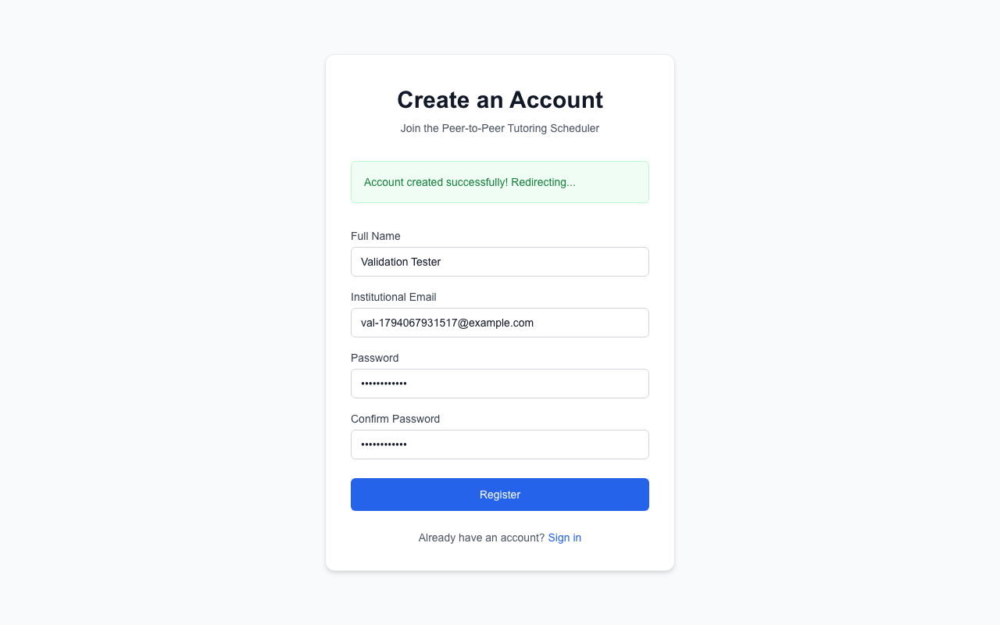 |
| S02 | Opened the verification link page | F-002 | 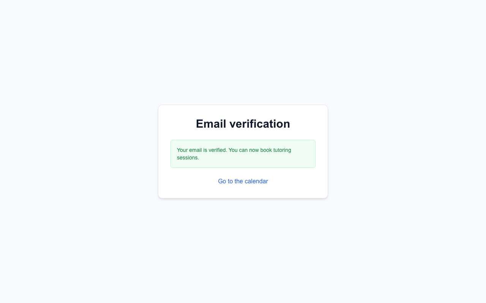 |
| S03 | Logged in as a learner | F-003 | 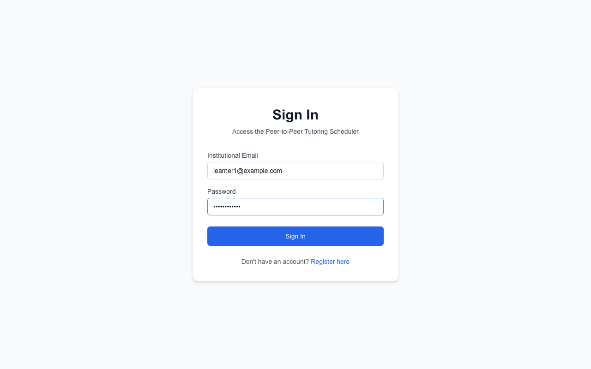 |
| S04 | Calendar month view | F-009 | 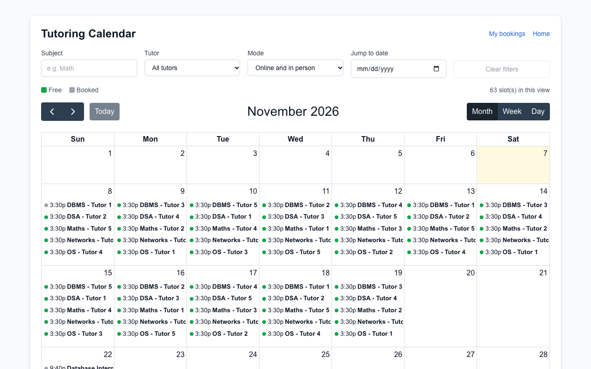 |
| S05 | Calendar week and day views | F-009 | 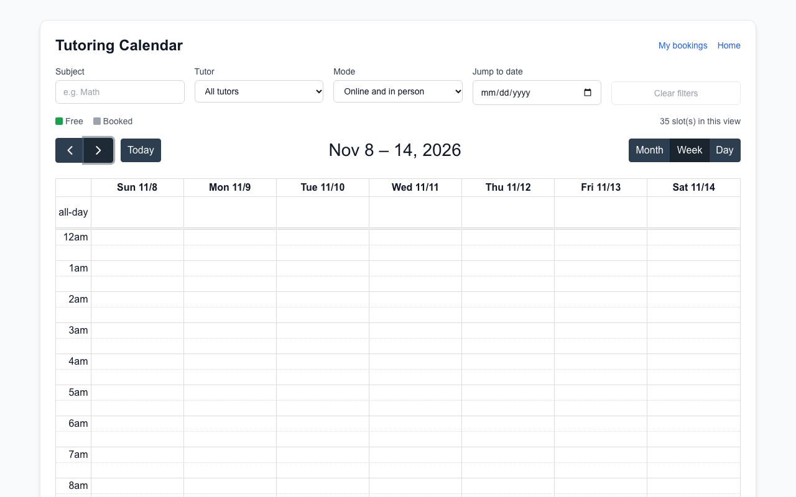  |
| S06 | Filter by subject DBMS | F-010 | 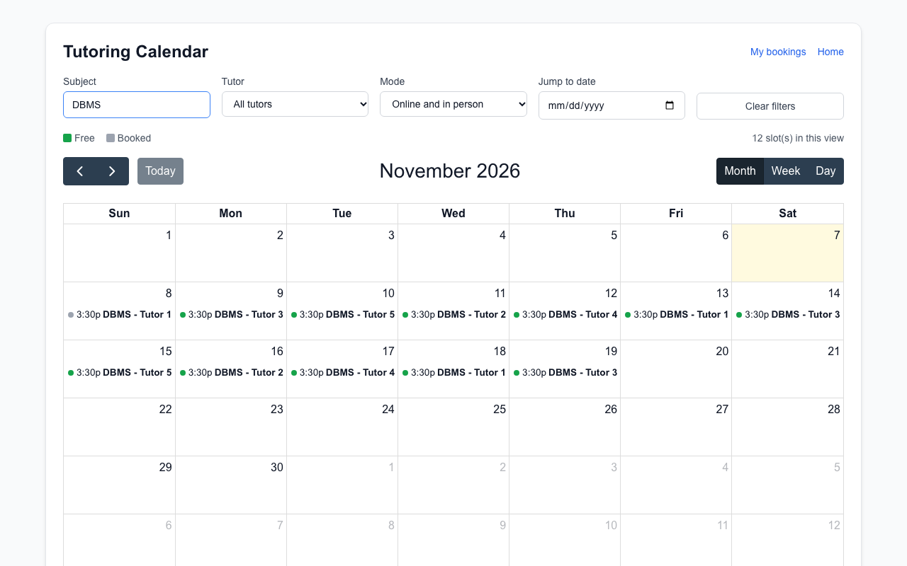 |
| S07 | Booked a free slot, success message | F-012, NF-005 | not captured |
| S08 | Tried to book a taken slot, alternative slots shown | F-014, F-015 | 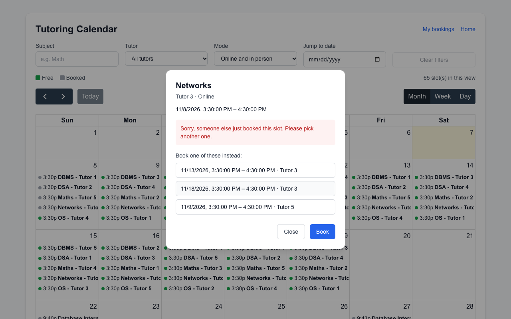 |
| S09 | My bookings with Cancel and Reschedule | F-016, F-017 | 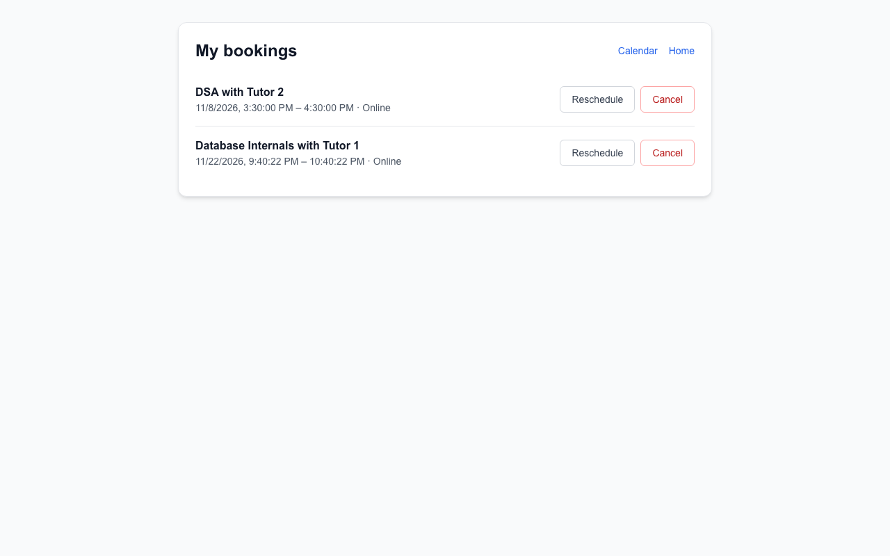 |
| S10 | Tutor created a weekly recurring series | F-005, F-006 | 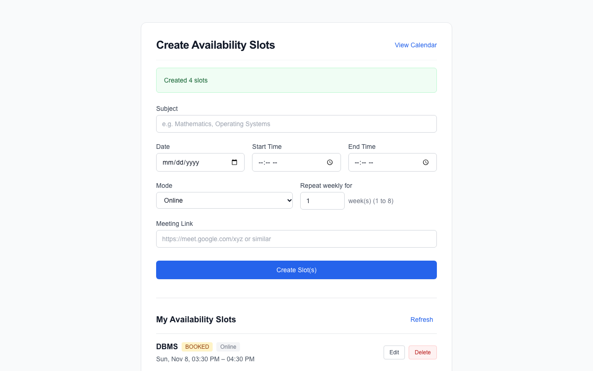 |
| S11 | Tutor deleted a booked slot, warning shown | F-008 | 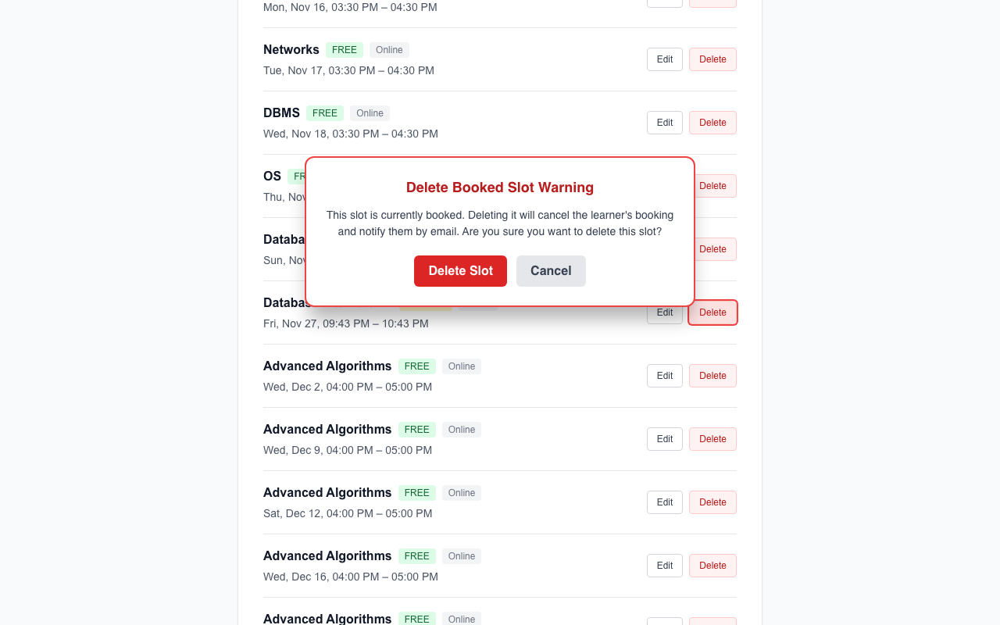 |
| S12 | Playwright HTML report summary | E2E | 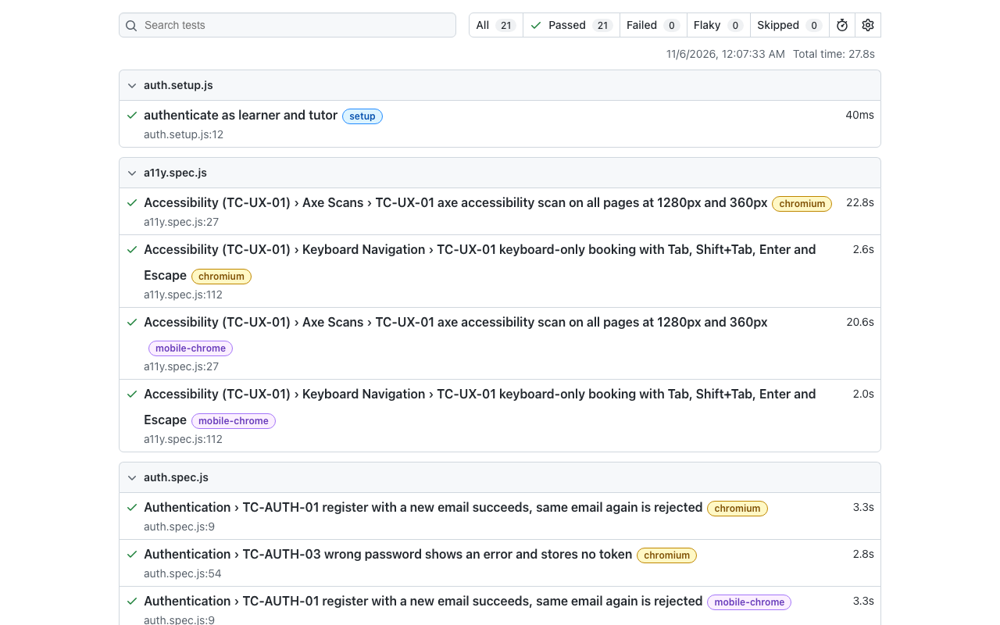 |
| S13 | k6 summary in the terminal | NF-001 | 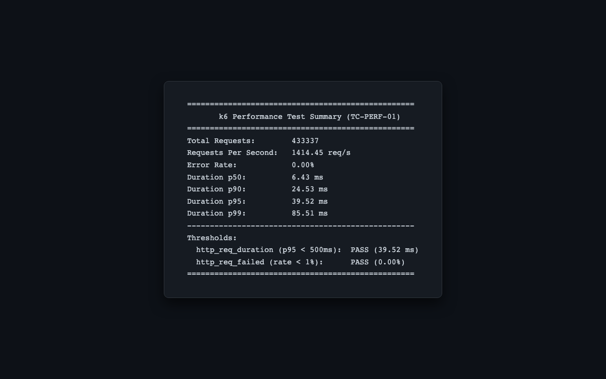 |

Walkthrough confirmation for S04 and S05: month, week and day views all displayed correctly and rendered events.

## 7. Known issues and gaps

| ID | Issue | Requirement | Severity | Jira |
|---|---|---|---|---|
| D-1 | Neighbouring-month day numbers on the calendar have contrast 1.94:1 (A-1) | NF-004 | Serious | [add key] |
| D-2 | Calendar day cells have a label/name mismatch (A-2, FullCalendar) | NF-004 | Serious | [add key] |
| D-3 | "Online" badge on /my-slots has contrast 4.39:1 (A-3) | NF-004 | Serious (one-line fix) | [add key] |
| D-4 | Booking dialog does not close on Escape (confirmed in the browser) | NF-004 | Minor | [add key] |
| D-5 | Learner cancel sends no email to either party | F-016 | Medium | [add key] |
| D-6 | Own bookings are not shown in a distinct style on the calendar | F-011 | Medium | [add key] |
| D-7 | Reviews and admin moderation are not built | F-023, F-024 | Planned for a later sprint | PTS-34, PTS-35 |
| D-8 | Staging smoke job fails: the staging API on Render does not answer its health check. Staging is not validated | PTS-37 | Medium | [add key] |
| D-9 | Booking path not measured under load because of the per-learner rate limit (section 3) | NF-001 | Test limitation | n/a |
| D-10 | No tests for first-paint time, reminder survival across restarts, three-operating-system run, secret scanning, HTTPS, or an OWASP ZAP scan | NF-002, NF-003, NF-007, SR-001, SR-005, SR-006 | Gap | n/a |

## 8. Conclusion

The core flows (register, log in, publish and manage slots including weekly series, browse, book, cancel, reschedule, notifications with retries) work and are covered by 106 passing backend tests and 21 passing browser tests. Booking is safe under concurrent requests. The browsing API is fast: p95 of 39.52 ms against a 500 ms target at 100 users.

The system does not yet meet the SRS in full. Reviews and admin moderation are not built, learner cancellation sends no email, own bookings are not styled on the calendar, two pages have serious accessibility violations, the booking path was not measured under load, staging is not validated, and five security and reliability requirements have no test. These items are listed in section 7 for the final deviations note (PTS-39).

## Appendix: notes for the RTM (PTS-42)

The RTM was generated on 7 November before the Playwright, axe and k6 results were added, so it still marks them "Not run". Their results are in this report and the RTM statuses for TC-AUTH-01, TC-AUTH-03, TC-CAL-02, TC-UX-02, TC-BOOK-01, TC-BOOK-05, TC-SLOT-02 and TC-SLOT-04 (E2E rows) can change to Passed; TC-UX-01 to Partial; TC-PERF-01 to Passed with the limitation in section 3.
